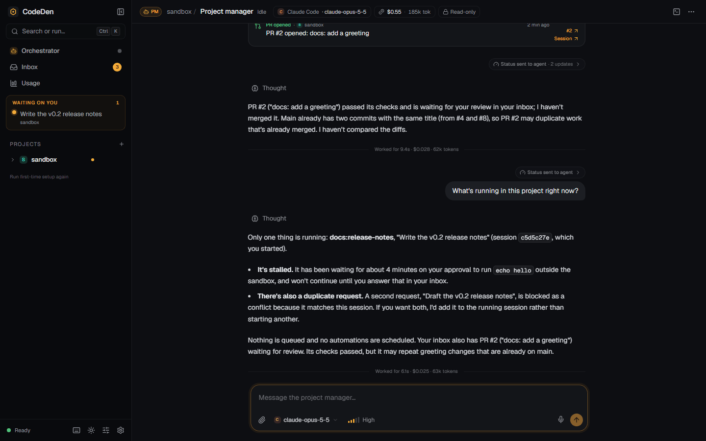
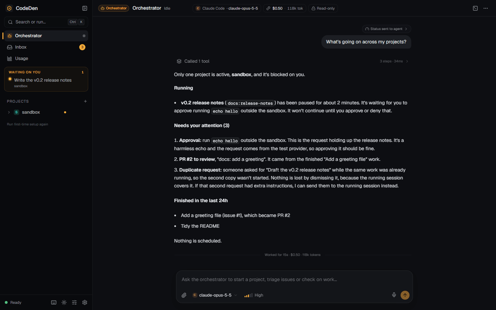
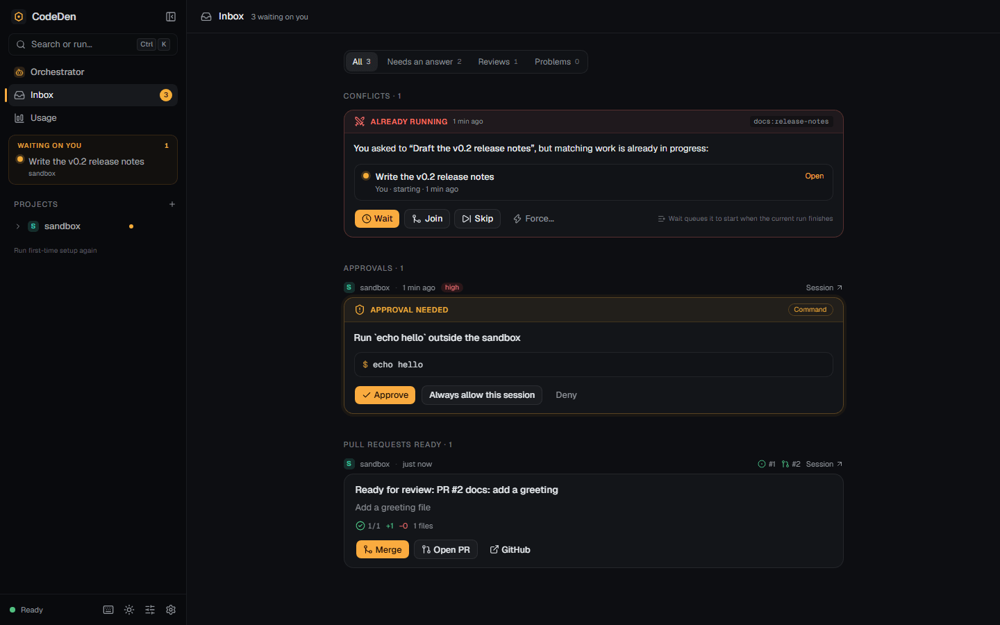

# Orchestration

CodeDen runs three kinds of agent: one **orchestrator**, one **project manager (PM)** per project, and any number of **agent sessions**. They're all ordinary agent sessions on Claude Code or Codex; what differs is their role, system prompt, working directory and tools.

| Role | How many | Works in | Can edit code? | Purpose |
|---|---|---|---|---|
| Orchestrator | 1 | `~/.codeden/orchestrator/` | No | Your front door: creates and configures projects, routes requests to PMs, summarises status across projects |
| Project manager | 1 per project | The project root, read-only | No | Triages issues, plans work, starts and steers agent sessions, reviews results, escalates to you |
| Agent | Many | Its own worktree and branch | Yes | Does the work: code, tests, PRs, evidence |

The orchestrator and PMs run **read-only**: Claude gets no edit tools and a policy that denies writing commands, Codex gets a read-only sandbox. They act only through CodeDen's tools. Choose the provider, model and effort for each role in **Settings → Providers** (Claude Code is the default for the orchestrator and PMs when it's available).

## How work flows

1. **Work arrives.** You ask the orchestrator or a PM, you start a session yourself, a PM picks up a GitHub issue, or an automation fires.
2. **A session starts.** The PM (or you) names a provider, model, brief and optionally an issue. CodeDen creates the worktree and branch and starts the session in the runner.
3. **The agent works.** It may ask questions or request approvals (both land in your inbox), share screenshots, report progress, and finally open a PR with evidence linked to the issue.
4. **Notices wake the PM.** Session and GitHub events become typed notices, batched into an "updates since your last turn" summary.
5. **The PM decides.** It follows up with the agent, reports to the orchestrator, or asks you. It never merges on its own; automatic merges only happen in the [factory modes](autonomy-and-dark-factory.md).
6. **The orchestrator wakes only for what matters.** PMs can mark messages as informational so routine updates don't wake it.

## Talking to them

- **Orchestrator:** pinned at the top of the sidebar (**Alt+O**). Try "What's going on across my projects?", "Create a project for C:\code\api", or "Ask the storefront PM to look at issue 12".
- **PM:** under each project in the sidebar, or **Talk to the PM** on the project page.

Both chats show the role badge, the model, the running cost and a **Read-only** marker in the header.

## Status digests

Every time the orchestrator or a PM wakes (you message it, a notice arrives, another role asks it something), CodeDen prepends a fresh, compact status block to its input, so it knows the current state without spending a tool call:

- **PM digest:** running and queued sessions (work key, purpose, status, last progress, age), the next scheduled automation runs, open inbox items, and recent finishes and failures.
- **Orchestrator digest:** the same, rolled up per project.

In the transcript this shows as a folded **Status sent to agent** marker you can expand.

## Notices

Notices are structured records, not text to be parsed back. They render as cards in the PM and orchestrator chats.

| Notice | When |
|---|---|
| `session.finished`, `session.needs_input`, `session.failed` | A session ended its work, is waiting on you, or failed |
| `pr.opened`, `pr.checks_passed`, `pr.checks_failed`, `pr.merged` | GitHub sync saw a PR change |
| `review.submitted` | A review was submitted on a PR |
| `issue.opened` | A new issue arrived |
| `automation.skipped` | A scheduled run was skipped (overlap, quiet hours, daily cap, ...) |
| `conflict` | A start request matched running work |
| `pm.message` | A PM messaged the orchestrator |
| `factory.update` | The factory loop needs triage, or the daily digest is ready |

**Wake-ups are rate limited.** Notices about work started by a PM, the orchestrator or an automation wake the PM after a 5-second debounce (30 seconds at most), and each role is woken at most 6 times per 10 minutes. New issues always wake the PM; PRs that don't belong to a session wake it only for openings and reviews.

## Work keys and conflicts

Every session and automation run records **what** it is, so CodeDen can stop duplicate work before it starts:

| Field | Example |
|---|---|
| `startedBy` | you, the orchestrator, a PM or an automation (with its id) |
| `purpose` | "Write the v0.2 release notes" |
| `workKey` | `issue:142`, `pr:57`, `automation:security-audit`, `request:write-the-v0-2-release-notes` |
| `scope` | the project, optionally narrowed to paths (`src/auth`) or an area (`ui`) |
| progress | the agent's last `report_progress` line |

If you don't give a work key, CodeDen derives one: `issue:<n>` when an issue is linked, otherwise `request:<slug of the purpose>`. You can set one in the **New session** dialog.

**Conflict check.** Starting a session, running an automation or a scheduled trigger first looks for running or queued work in the same project with the **same work key**, or the **same kind** of work (the part before the colon) with an **overlapping scope** (the same area, or paths where one contains the other). Work scoped to the whole project never counts as overlapping.

When there's a match, nothing starts. Instead you (or the PM) get the existing work's details and four choices:

| Choice | Effect |
|---|---|
| **Wait** | Queue behind the existing work |
| **Skip** | Don't start anything |
| **Join** | Send the request to the existing session as a follow-up |
| **Force** | Start anyway; the reason is recorded |

A conflict from something you started appears as a card in place and in the inbox. Example: you ask the orchestrator for a security audit; it asks the PM, which sees `automation:security-audit` already running and replies with its progress and the options. Nothing is duplicated.

## Now / Next

Each project page shows a **Now / Next** strip: what's running and the upcoming scheduled automation runs. From there you can skip the next run of a schedule. PMs can do the same with `skip_next_run`, for example when an audit you started by hand will still be going at the scheduled time.

## Tools by role

Agents see only the tools for their role; everything else isn't listed at all. The core and situational-awareness tools are always loaded; the rest sit behind tool search so they don't fill the context window.

| Role | Tools |
|---|---|
| Orchestrator | `get_overview`, `list_projects`, `create_project`, `update_project`, `message_pm`, `ask_pm`, `list_inbox` |
| PM: sessions and status | `get_project_status`, `list_sessions`, `start_session`, `message_session`, `stop_session` |
| PM: automations | `list_automations`, `run_automation`, `list_scheduled_runs`, `skip_next_run`, `pause_automation`, `resume_automation`, `cancel_queued_run` |
| PM: issues and PRs | `list_issues`, `get_issue`, `triage_issue`, `create_issue`, `report_triage`, `comment_on_issue`, `get_pr_status` |
| PM: other | `message_orchestrator`, `read_project_notes`, `update_project_notes` (`.codeden/notes.md`), `ask_user` |
| Agent | `report_progress`, `ask_user`, `share_to_chat`, `suggest_followups`, `finish`, `create_pull_request`, `attach_evidence`, `comment_on_issue`, `get_pr_status`, the `browser_*` tools |
| Everyone | `generate_image` (when an image engine is available) |

Factory projects add a few more (see [Autonomy and the dark factory](autonomy-and-dark-factory.md)).

### Asking and answering

- **`ask_pm`** (orchestrator → PM) waits up to 3 minutes for the PM's answer; a later answer arrives as a message.
- **`message_orchestrator`** with `informational: true` never wakes the orchestrator; it shows in its next digest.
- **`ask_user`** (agent or PM → you) puts a question card in the transcript and the inbox. The tool waits up to 4 minutes; if you haven't answered, the agent is told to finish what it can, and your later answer is sent to the session as a new message. This works the same on every provider.

## The inbox

The inbox collects everything waiting on you:

| Kind | Examples |
|---|---|
| Question | An agent or PM used `ask_user` |
| Approval | A risky action under the default autonomy level |
| PR review | A session's PR is out of draft and its checks passed |
| Failed run | A session or automation run failed |
| Triage | "Should I take this on?" for a triaged issue |
| Conflict | A start request that matched running work |
| Automation result | Results flagged for attention, the factory digest, budget alerts |
| Message | A message addressed to you |

Each item links to its session, issue and PR, and can be answered in place. The sidebar shows the count, and the **Waiting on you** box lists the top items. Toasts are on by default; browser notifications are opt-in in **Settings → Notifications**.

